  

## 📌 About Me

I'm Soroush, a computer engineering student at the University of Arak. I build production web systems and desktop apps, mostly with Laravel/PHP and C#/.NET. I care about architecture that holds up, APIs that are a pleasure to integrate, and tests that actually catch things.

## 🔭 Currently

- Built the API layer of a production e-commerce platform — a consistent JSON:API surface, Sanctum auth with phone + OTP sign-in, threaded review workflows, and audit-logged account changes, all behind a suite of more than 2,700 tests.
- Building a Windows desktop app for records-heavy teams — WinUI 3 and EF Core on Clean Architecture, a Persian RTL interface, and role-based access across six roles.
- Exploring multi-tenant SaaS architecture, T-SQL internals, Temporal/gRPC workflows, and web-security topics.

## 🛠 What I Work With

**Backend & APIs:** 

**Frontend:** 

**Data:** 

**Tools:** 

## 🧭 Where I'm Heading

## 📊 GitHub

  

## 📫 Reach Me

  

